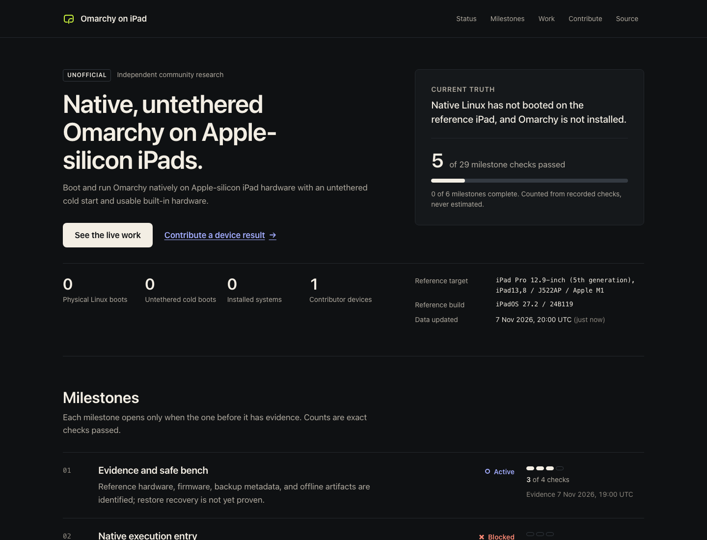

<p align="center">
  
</p>

<p align="center">
  <a href="https://github.com/baney75/omarchy-on-ipad/actions/workflows/ci.yml"></a>
  <a href="https://github.com/baney75/omarchy-on-ipad/actions/workflows/pages.yml"></a>
  <a href="SECURITY.md"></a>
  <a href="LICENSE"></a>
</p>

# Native Omarchy on Apple-silicon iPads

This is an open, evidence-driven effort to run [Omarchy](https://github.com/omacom/omarchy) natively on Apple-silicon iPad hardware, with an untethered cold start and usable built-in hardware.

> **Current truth:** native Linux has not booted on the reference iPad, and Omarchy is not installed. The dashboard currently records **5 of 29** milestone checks passed.

[Open the live progress dashboard](https://baney75.github.io/omarchy-on-ipad/) · [Publish a progress update](https://github.com/baney75/omarchy-on-ipad/issues/new?template=progress-update.yml) · [Contribute a device result](CONTRIBUTING.md)



## What makes this useful

- **Live, not promotional.** Every merge rebuilds GitHub Pages from `data/progress.json` and reviewed contribution records.
- **Evidence has levels.** Prepared work, offline verification, physical verification, and completion are different states.
- **Other devices can join.** Owners of Apple-silicon iPads and Macs can submit sanitized, read-only device records and bounded research results.
- **Work can be followed as it happens.** Contributors and disclosed agents can publish structured progress issues; only reviewed evidence changes the dashboard's claims.
- **Agents can contribute safely.** `AGENTS.md` and `CLAUDE.md` give Daybreak, Claude Code, and local agents the same truth and safety contract.
- **Security-sensitive work stays coordinated.** Possible entry paths and exploit details use private vulnerability reporting, not public issues.

## The path to the goal

1. Establish a safe, reproducible evidence bench.
2. Establish native execution authority on production Apple-silicon iPad hardware.
3. Boot a minimal Linux system from RAM and return safely to iPadOS.
4. Bring up J522-class display, touch, Pencil, storage, power, USB, and networking.
5. Integrate and verify the real Omarchy ARM userspace.
6. Prove recovery, installation, rollback, and repeated untethered cold boots.

The exact pass criteria live in [`data/progress.json`](data/progress.json). The dashboard calculates its headline from those checks; there is no hand-set completion percentage.

## Start contributing

You need a Mac, an Apple-silicon iPad you own or are authorized to test, a cable, Python 3, and Xcode command-line tools for the safest first contribution.

```sh
python3 tools/collect_readonly.py --output my-device.json
cat my-device.json
make check
```

The collector outputs only allowlisted model/build fields. It deliberately drops names, serial numbers, device identifiers, addresses, and account data. Read the output before attaching it anywhere. Then follow [CONTRIBUTING.md](CONTRIBUTING.md).

Do not post a suspected exploit, malformed sample, firmware payload, device secret, private framework artifact, or third-party binary. Use [private vulnerability reporting](SECURITY.md) for a possible entry path.

## How the live site works

```text
data/progress.json + data/contributions/*.json
                 │
          schema and truth checks
                 │
       dependency-free Python builder
                 │
        generated static GitHub Pages
```

Pull requests run data validation, privacy and artifact gates, unit tests, a malware scan, and a clean site build. Merges to `main` deploy the site. External contributors never receive deployment credentials.

## Repository map

| Path | Purpose |
| --- | --- |
| `data/` | Public progress, device coverage, and reviewed contribution records |
| `schemas/` | Machine-readable contracts for progress and contributions |
| `site/` | Accessible, dependency-free dashboard templates and original visual assets |
| `scripts/` | Validation, public-surface checks, and the static site builder |
| `tools/` | Safe contributor tools, beginning with the read-only inventory collector |
| `docs/` | Roadmap, claim ladder, governance, credits, brand, and sharing material |
| `.github/` | CI, Pages, issue forms, dependency updates, and review ownership |

## Project boundaries

This repository is the sanitized public coordination surface. It does not publish private device identifiers, local machine details, copyrighted firmware, signing material, live credentials, weaponized exploit chains, or unreviewed physical-test instructions. A successful build, emulator run, or offline package check is not a native iPad boot.

## Upstream credit and independence

This project depends on and learns from Omarchy, Asahi Linux, m1n1, Linux, Orchard Linux, Hoolock, and other cited work. See [CREDITS.md](CREDITS.md) for links, roles, and licenses.

This is an **unofficial, independent community research project**. It is not affiliated with, endorsed by, or sponsored by Apple Inc., 37signals LLC, or the Omarchy project. `OMARCHY` is a registered trademark of 37signals LLC in the United States for operating-system software. The name is used here only to identify the upstream system the project is attempting to port. See [TRADEMARKS.md](TRADEMARKS.md).

## License

Original code, site design, documentation, and project data in this repository are available under the [MIT License](LICENSE), except third-party material identified in [CREDITS.md](CREDITS.md). Device firmware and upstream project code are not redistributed here.
